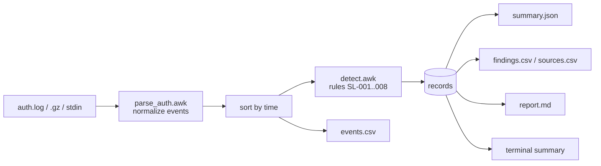
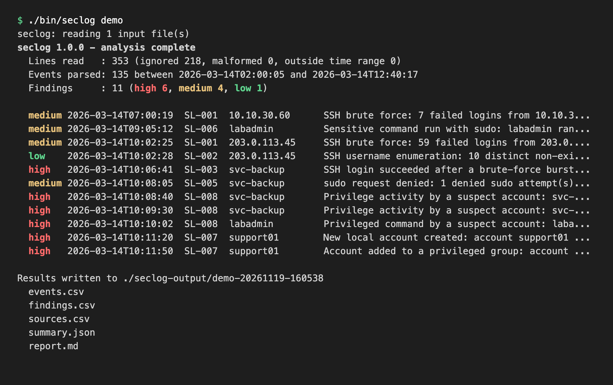
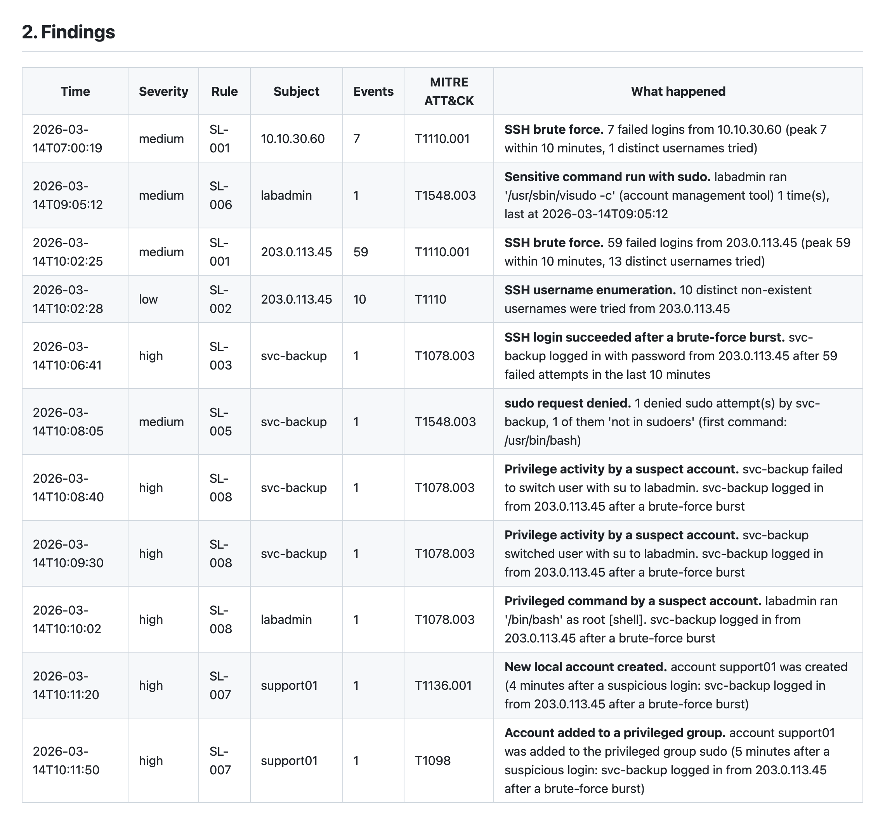
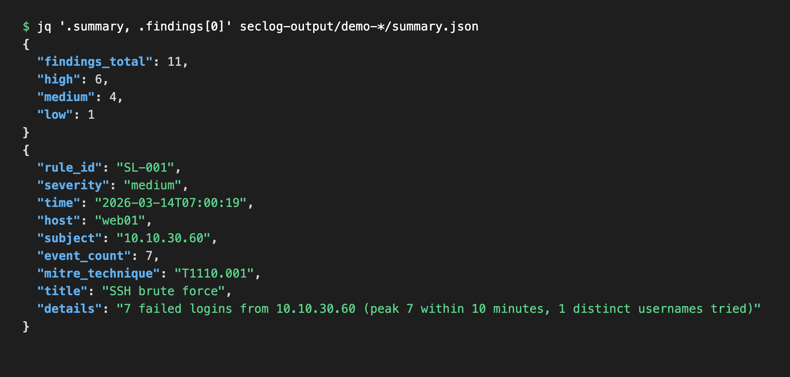
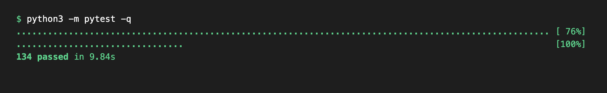

# Security Log Automation Toolkit (`seclog`)

[](https://github.com/OYDeadpoolife/security-log-automation/actions/workflows/ci.yml)

`seclog` is a small command-line tool, written in Bash and awk, that reads Linux authentication logs
(`/var/log/auth.log`), finds signs of password guessing, a suspicious successful login and privilege
abuse, and writes the result as **JSON, CSV and a readable Markdown report**. It needs no database,
no SIEM and no Python at run time, and it never modifies the logs it reads.

> **Status:** Version 1.0.0. Tests pass on macOS (Bash 3.2, BWK awk) and, in GitHub Actions, on Ubuntu with
> mawk, gawk and original-awk — see [TEST_RESULTS.md](TEST_RESULTS.md).
> All sample data is **synthetic**. This is a learning and portfolio project, not a production monitoring product.

## In plain words

Every Linux server keeps a diary of who tried to log in and who used administrator powers (the file `/var/log/auth.log`).
Reading that diary by hand is slow. `seclog` reads it for you, points out the suspicious parts (for example someone guessing
passwords again and again and then getting in) and writes a short report that a person can read. It only reads the file and
never changes it. All the example data is made up. New to these terms? See the [glossary](docs/glossary.md).

## For a recruiter or SOC manager (30 seconds)

* **Problem:** an analyst facing a raw `auth.log` has to answer "was anyone brute-forced, did a login
  succeed, and what did that account do next?" by hand.
* **What this does:** automates that first triage, explains every finding with a rule ID and a MITRE ATT&CK
  tag, and produces a report plus machine-readable files that can be loaded into Splunk or Elastic.
* **What it shows about the author:** Bash and awk text processing, defensive input handling,
  automated testing (134 tests), clear documentation and honest limitations.
* **Where it fits:** step 3 of a four-project defensive workflow
  (network events → SOC detection → **log analysis automation** → DFIR). Each project works on its own.

## Main objectives

1. Parse Linux authentication logs (OpenSSH, `sudo`, `su`, account tools).
2. Identify repeated failed logins and a successful login that follows them.
3. Analyse `sudo` and other privilege activity.
4. Accept user-defined time ranges and input paths (files, directories, `.gz`, standard input).
5. Produce JSON, CSV and Markdown output; print a coloured summary on the terminal.
6. Stay safe: read-only on inputs, never overwrite results, no root, no installs, no network.

## Technologies

Bash (3.2 and newer), awk (BWK awk, mawk and gawk are supported), standard POSIX tools (`sort`, `grep`, `tr`, `find`),
Python 3 with pytest for the test suite only, ShellCheck and shfmt for code quality, GitHub Actions for CI.

## Features

| Area | What you get |
|---|---|
| Parsing | Traditional syslog and ISO-8601 timestamps, rotated `.gz` files, files without a final newline, hostile or binary content |
| Detection | 8 explainable rules (SL-001 … SL-008) with thresholds you can change on the command line |
| Output | `summary.json`, `events.csv`, `findings.csv`, `sources.csv`, `report.md` |
| Safety | Results are written to a new directory only; temporary files are removed; private file permissions (`0600`) |
| Operations | `--help`, `--version`, `--dry-run`, `demo` mode, documented exit codes, a cron wrapper and cron examples |

## How it works



**How to read the diagram:** the log file goes in on the left. The tool turns each line into a structured event, sorts the events
by time and applies the detection rules. The results come out on the right as files for other programs (JSON and CSV), a readable
report (`report.md`) and a summary printed in the terminal.

Every stage is plain text, so each intermediate step can be inspected. See [docs/architecture.md](docs/architecture.md).

## Requirements

* Bash 3.2 or newer, a POSIX `awk` (macOS awk, mawk or gawk), `sort`, `grep`, `tr`, `find`, `gzip`, `date`, `mktemp`.
  These are present on a default macOS, Ubuntu, Debian and Kali installation.
* For the tests only: Python 3.8+, `pytest`; ShellCheck and shfmt are optional (`pip install -r requirements-dev.txt`).

## Quick start

```bash
git clone https://github.com/OYDeadpoolife/security-log-automation.git
cd security-log-automation
./bin/seclog demo
```

`demo` analyses the bundled synthetic log `samples/auth.log` and writes the results to a new directory under
`./seclog-output/`. It reads nothing else and needs no permissions.

## Usage

```bash
# Analyse a real log (the account needs read access to it; the tool never asks for root)
./bin/seclog analyze --input /var/log/auth.log --year 2026

# One day only, ignoring a trusted scanner, with custom thresholds
./bin/seclog analyze -i /var/log/auth.log --since 2026-03-14 --until 2026-03-14 \
    --exclude-ips 10.10.30.60 --failed-threshold 10 --window-minutes 5 -o ./reports/2026-03-14

# Several files, including rotated and compressed ones
./bin/seclog analyze -i /var/log/auth.log -i /var/log/auth.log.1 -i /var/log/auth.log.2.gz

# Check the plan without reading anything in full or writing anything
./bin/seclog analyze -i /var/log/auth.log --dry-run
```

All options, exit codes and file formats are described in [docs/usage.md](docs/usage.md).
For recurring analysis see [examples/cron/seclog.cron](examples/cron/seclog.cron).

## Expected output

Running `./bin/seclog demo` prints (shortened):

```text
seclog 1.0.0 - analysis complete
  Lines read   : 353 (ignored 218, malformed 0, outside time range 0)
  Events parsed: 135 between 2026-03-14T02:00:05 and 2026-03-14T12:40:17
  Findings     : 11 (high 6, medium 4, low 1)

  medium 2026-03-14T07:00:19  SL-001  10.10.30.60      SSH brute force: 7 failed logins from 10.10.3...
  medium 2026-03-14T10:02:25  SL-001  203.0.113.45     SSH brute force: 59 failed logins from 203.0....
  high   2026-03-14T10:06:41  SL-003  svc-backup       SSH login succeeded after a brute-force burst...
  high   2026-03-14T10:10:02  SL-008  labadmin         Privileged command by a suspect account: laba...
  high   2026-03-14T10:11:20  SL-007  support01        New local account created: account support01 ...
```

The complete output of the same run is committed in [examples/example-output/](examples/example-output/):
[report.md](examples/example-output/report.md), [summary.json](examples/example-output/summary.json) and the CSV files.

The story in the sample log (fully fictional): an internet host guesses SSH passwords against `web01`, one guess for
the service account `svc-backup` succeeds, the account is used to reach `labadmin` with `su`, `sudo /bin/bash` gives a root
shell, and a new account `support01` is added to the `sudo` group. The 7 failures from `10.10.30.60` are an
authorised vulnerability scanner — a deliberate **false positive** that `--exclude-ips` removes.

## Detection rules

| Rule | Detects | Severity | MITRE ATT&CK |
|---|---|---|---|
| SL-001 | ≥ N failed SSH logins from one source in M minutes | medium | T1110.001 |
| SL-002 | ≥ N distinct non-existent usernames from one source | low | T1110 |
| SL-003 | SSH login succeeds right after an SL-001 burst | high | T1078.003 |
| SL-004 | Direct `root` SSH login | medium | T1021.004 |
| SL-005 | `sudo` denied ("not in sudoers", wrong password) | medium | T1548.003 |
| SL-006 | Sensitive command run with `sudo` (shell, `su`, account tools, `/etc/shadow`, sudoers) | medium | T1548.003 |
| SL-007 | New local account, or account added to `sudo`/`admin`/`wheel`… | high | T1136.001 / T1098 |
| SL-008 | `su` or `sudo` by an account that logged in after SL-003 (follows the chain for 2 hours) | high | T1078.003 |

Reasoning, thresholds and false positives for each rule: [docs/detection-rules.md](docs/detection-rules.md).

## Screenshots

The images below are rendered from the real output of the commands shown, run on a clean clone of this repository. They are not
photographs of a terminal window, and nothing in them is edited. The commands are listed in [screenshots/README.md](screenshots/README.md).

**`./bin/seclog demo`** — the terminal summary:



**The generated `report.md`**, section "Findings":



**`summary.json`** checked with `jq`:



**The test suite:**



## Testing

```bash
python3 -m venv .venv && . .venv/bin/activate
pip install -r requirements-dev.txt
python3 -m pytest -v          # 134 tests: normal, empty, malformed, hostile and boundary inputs
make lint                      # ShellCheck + shfmt
```

What the tests cover, and what was and was not run, is recorded honestly in [TEST_RESULTS.md](TEST_RESULTS.md).
To run the tests with another awk: `SECLOG_AWK=gawk python3 -m pytest`.

## Limitations

* Rule-based with fixed thresholds: it can raise false positives and miss slow or distributed attacks.
* Only common OpenSSH, `sudo`, `su`, `useradd`, `usermod`, `gpasswd`, `passwd` and `userdel` message formats are understood.
* Syslog timestamps have no year or time zone; use `--year` and analyse logs from one time zone at a time.
* `useradd`/`usermod` do not log who ran them. Use auditd (`auid`) to attribute those actions — see the SOC lab project.
* Not performance-tuned for multi-gigabyte logs; the sliding window keeps per-source history in memory.

## Future improvements

* Support `journalctl -o short-iso` output and `lastb`/`wtmp` records.
* Add an allow-list file and per-user baselines (normal login hours and sources).
* Optional output as Splunk HEC or Elastic bulk files.

## Status and verification

Test results in this repository are real runs on the environment listed in [TEST_RESULTS.md](TEST_RESULTS.md).

## Author

**Orhay Yosef** — aspiring SOC / SIEM analyst. GitHub: [OYDeadpoolife](https://github.com/OYDeadpoolife)
· Repository: <https://github.com/OYDeadpoolife/security-log-automation>
· License: [MIT](LICENSE)
