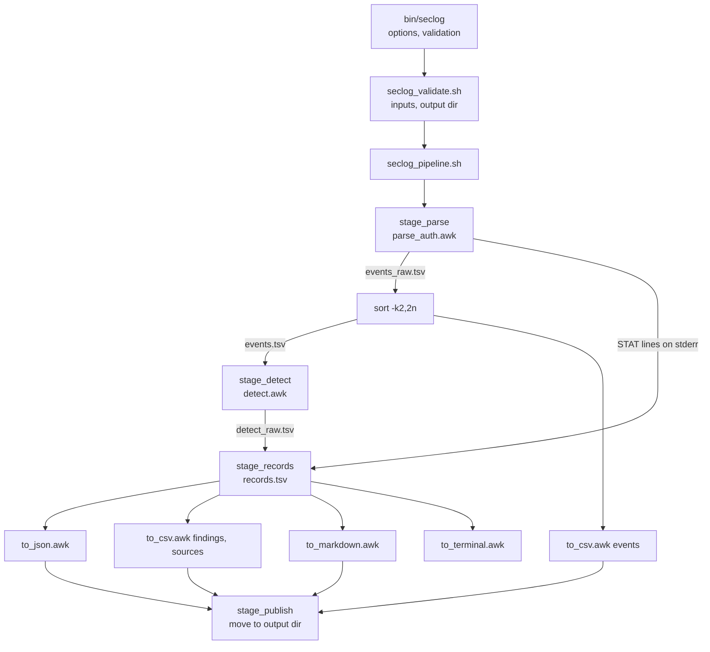

# Architecture

## Why this design

* **Plain text pipeline.** Every stage reads standard input and writes standard output, so you can run any stage
  by hand and look at its output with `less`, `awk` or `sort`. That is easier to debug and to explain than one large program.
* **awk for the heavy lifting.** Parsing and counting are what awk is good at, and it is installed everywhere.
  Bash only handles arguments, validation, temporary files and the order of the stages.
* **No Python at run time.** Fewer dependencies on a server you are investigating.
* **Nothing is written until everything succeeded.** All stages work inside a private temporary directory; the
  five result files are moved into the output directory at the very end.

## Data flow

### The normalized event (columns of `events.tsv`)

| # | Column | Example |
|---|---|---|
| 1 | timestamp | `2026-03-14T10:06:41` |
| 2 | epoch (seconds, used for time windows) | `1773482801` |
| 3 | host | `web01` |
| 4 | program | `sshd` |
| 5 | event_type | `ssh_accepted` |
| 6 | user | `svc-backup` |
| 7 | source | `203.0.113.45` |
| 8 | target (account switched to, created or changed) | `labadmin` |
| 9 | detail (method or command) | `password` |

### The records file

The first column is the record type: `META`, `INPUT`, `PARAM`, `STAT`, `EVTYPE`, `FINDING`, `SOURCE`, `SUDOUSER`.
All renderers read this one file, which is why JSON, CSV and Markdown always agree with each other.

## Files

| File | Role |
|---|---|
| `bin/seclog` | Entry point: usage text, option parsing, high-level flow, exit codes |
| `lib/seclog_common.sh` | Version, exit codes, colour, `die`, temporary directory, text sanitising |
| `lib/seclog_validate.sh` | Number, date and path checks; expands input directories; refuses to overwrite results |
| `lib/seclog_pipeline.sh` | The stages and how they are connected |
| `lib/awk/parse_auth.awk` | Raw log line → normalized event; epoch calculation; time-range filter; statistics |
| `lib/awk/detect.awk` | Rules SL-001…SL-008, sliding window per source, per-source and per-user statistics |
| `lib/awk/to_json.awk`, `to_csv.awk`, `to_markdown.awk`, `to_terminal.awk` | Renderers |
| `scripts/run_daily.sh` | Cron wrapper: one dated result folder per day, lock against overlapping runs |
| `samples/auth.log` | Synthetic log used by `demo` and the tests |
| `tests/` | pytest suite that runs the real tool against fixtures |

## Interesting implementation details (good for interviews)

* **Date maths without `mktime`.** `days_from_civil` converts a calendar date to a day count with integer arithmetic,
  because `mktime` is not available in every awk. The tests compare it with Python for leap years, the year 2100 and 2038.
* **Sliding window.** For every source the epoch of each failed login is stored; a head pointer moves forward past
  entries older than the window, so a window count is O(1) amortised.
* **Following a compromise.** After SL-003 the account is "suspect" for two hours. A `su` from a suspect account makes
  the target account suspect too, so the chain `svc-backup → labadmin → root shell` is reported as one story (SL-008).
* **Treating log data as hostile.** Usernames and commands come from an attacker. They are reduced to printable
  ASCII, JSON-escaped by a hand-written function, CSV-quoted with formula protection, and HTML-escaped in Markdown.
  Tests feed quote, backslash, pipe, HTML and formula payloads through all three outputs.
* **No `set -e`.** Failures are checked explicitly and reported through one `die` function with a documented exit
  code. Pipelines use `set -o pipefail` and the status of each stage is read from `PIPESTATUS`.
* **Bash 3.2 compatibility.** No associative arrays, `mapfile` or `${var,,}`; arrays are only expanded after checking
  they are not empty (bash 3.2 treats an empty array as unset under `set -u`).
* **awk operand trap.** Inputs reach awk through standard input, never as file arguments, because awk treats an
  operand like `x=1` as a variable assignment.
